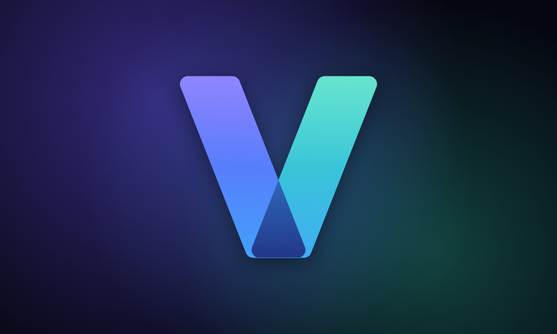

<div align="center">
  

  <h1>Velora</h1>
  
  
  
  
</div>

<p align="center">
  <b>Velora</b> is a cinematic Apple TV app for your own <a href="https://github.com/jellyfin/jellyfin">Jellyfin</a> media server.
  It is built on <a href="https://github.com/jellyfin/Swiftfin">Swiftfin</a>, with its own design, brand and avatars, and keeps Swiftfin's Jellyfin sign-in and playback underneath.
</p>

## ✨ Features

### Profiles
- **Who's watching, every time.** Velora asks who's watching each time it opens or returns from the background.
- **Launch ident.** An aurora rises, and the Velora ribbon runs down, folds and rises into the V before the profiles appear.
- **Profile column on glass.** Profiles sit on a glass panel over artwork from your own library. The chosen profile glides to the centre while it signs in.
- **32 avatars.** There are 16 original Velora characters: otter, koala, axolotl, sloth, hedgehog, raccoon, narwhal, capybara, chameleon, bunny, octopus, lion cub, frog, bee, unicorn and whale. The 16 classic characters are kept as well. Long-press a profile to choose one.
- **Sign in with your phone.** Use Quick Connect by scanning a QR code, or sign in with the remote.

### Home
- **Tabs.** Home, Movies, TV Shows, **My Velora** (your list), Search and Settings.
- **Featured banner.** Rotates through titles with backdrop art, with Play / Resume and More Info buttons.
- **Rows built from your library:**
  - Continue Watching and Recently Added.
  - **Top 10** charts for movies and shows.
  - Category rows such as Sci-Fi, Thrillers, Romance, Animation, Documentaries, Kids, Reality, Made in Korea and South Indian Cinema. A row only appears when your server has titles for it.
- **Posters that open up.** The focused poster expands into a wide card with the title's logo and progress.
- **Chart positions.** A title's position appears in a glass tile on its artwork, and titles in a chart get a small Top 10 pill in other rows.

<sub>Jellyfin has no server-wide popularity data, so the Top 10 charts rank recent titles by community and critic ratings.</sub>

### Details
- **Metadata line.** Year, runtime and the content rating, followed by **Velora format pills**:
  - picture: 4K/HD, Dolby Vision, HDR10, HDR10+ and HLG;
  - sound: Dolby Atmos, Dolby Digital, DTS, DTS-HD, DTS:X, TrueHD, 5.1 and 7.1;
  - accessibility: CC, SDH and AD.
- **Info panel.** Information, Languages and Accessibility on a glass panel, plus cast and director credits.

### Playback
- **Three players.** VLC is the default. Apple's AVPlayer and MPV are also available.
- **Automatic switch for 4K and HDR.** 4K and HDR titles chosen with VLC play through AVPlayer instead, for smooth hardware-decoded video. If the selected subtitles are image-based, VLC is kept.
- **Remuxed HEVC.** HEVC in MKV is remuxed by the server rather than re-encoded.
- **Larger buffers.**

  | Player | Buffer |
  |---|---|
  | AVPlayer | 60 s forward |
  | MPV | 400 MiB ahead, 100 MiB back, 60 s network cache |
  | VLC | 3 s network caching |

- **Playback info.** Shows the player in use and whether the stream is direct, remuxed or transcoded.

### Design
- **Liquid Glass** on buttons, chips, badges, panels and the profile bar. Focused buttons fill with Velora violet.
- **One palette.** Violet `#6E54FF`, sky `#40A8FA` and mint `#33E0B8` on a blue-black night. The default accent everywhere is Velora violet, and you can change it in Settings.
- **Gradient details.** Focus rings, progress bars and the player timeline use the brand gradient.

## 🎨 Brand



The Velora mark is a single ribbon folded into a V. It runs down the violet arm, folds at the base, where its darker underside shows, and rises again as the mint arm. The app icon is the mark alone, and the Top Shelf image pairs it with the lowercase name.

All brand art is drawn in code, so it is original and free to change:

| What | Where |
|---|---|
| Mark, wordmark and launch ident | `Swiftfin tvOS/Components/Cinema/VeloraWordmark.swift` |
| Format glyphs | `Swiftfin tvOS/Components/Cinema/VeloraFormatGlyph.swift` |
| Colours, glass and sizes | `Swiftfin tvOS/Components/Cinema/CinemaTheme.swift` |
| App icon and Top Shelf images | `Scripts/Brand/render-brand.swift` |

To regenerate the icon layers and Top Shelf images after changing the mark, run this from the repository root (previews go to `build/brand/velora`):

```sh
swift Scripts/Brand/render-brand.swift build/brand/velora
```

## 📺 Requirements

- Apple TV with **tvOS 26.1** or later. It is built and run on an Apple TV 4K.
- A **Jellyfin** server that the Apple TV can reach.
- To build it: a Mac with **Xcode 26.5** or later, and an Apple ID. A free account works.

## 🛠️ Build and install

1. Clone the repository:

   ```sh
   git clone https://github.com/ravikishore-m/velora-tvos.git
   cd velora-tvos
   ```

2. Create `XcodeConfig/DevelopmentTeam.xcconfig` with your own signing details. The file is gitignored, so it never leaves your Mac:

   ```
   DEVELOPMENT_TEAM = <your team ID>
   PRODUCT_BUNDLE_IDENTIFIER = <a bundle ID of your own, e.g. com.yourname.velora>
   ```

3. Pair the Apple TV with Xcode under **Window › Devices and Simulators**. On the TV, open **Settings › Remotes and Devices › Remote App and Devices**.

4. Open `Swiftfin.xcodeproj`, choose the **Swiftfin tvOS** scheme and your Apple TV, and run. Or build from the command line:

   ```sh
   xcodebuild -project Swiftfin.xcodeproj -scheme "Swiftfin tvOS" -configuration Release \
     -destination 'id=<Apple TV UDID>' -allowProvisioningUpdates \
     -skipMacroValidation -skipPackagePluginValidation build
   ```

> [!NOTE]
> With a free Apple ID, the app's provisioning profile expires **7 days** after each build. Velora then stops opening until it is installed again. The automatic deploy below re-signs it for you.

## 🔁 Automatic deploys to Apple TV

`Scripts/Deploy` keeps the Apple TV up to date from a Mac that stays on. It works like GitOps: the branch says what should be installed, and a LaunchAgent makes the TV match it.

- **It deploys in three cases:**
  - when the branch has a new commit;
  - at least every 5 days with no changes, to re-sign before the free profile lapses;
  - when you force it, with `--force` or by touching `~/Library/Caches/VeloraDeploy/requests/force`.
- **Your working copy is never touched.** It builds in its own git worktree, using your `DevelopmentTeam.xcconfig`.
- **Hourly checks.** The agent checks every hour, and immediately when you push to `~/velora-deploy.git`.
- **Notifications.** A macOS notification says whether each deploy succeeded or failed.

Install it once, passing the Apple TV's identifiers. Use the device ID from `xcrun devicectl list devices` and the UDID from `xcrun xctrace list devices`:

```sh
Scripts/Deploy/install-launch-agent.sh <devicectl device id> <xcodebuild UDID> [branch]
```

This creates the bare deploy repository `~/velora-deploy.git`, adds it as the `tv` remote and loads the `com.velora.deploy` agent. From then on, deploy by pushing:

```sh
git push tv
```

Logs are in `~/Library/Logs/VeloraDeploy/deploy.log`. To remove the agent:

```sh
Scripts/Deploy/install-launch-agent.sh --uninstall
```

### Deploying from anywhere over Tailscale

With [Tailscale](https://tailscale.com) on the Mac and on your laptop, and **Remote Login** turned on in the Mac's **System Settings › General › Sharing**, you can deploy from anywhere on your tailnet:

```sh
git remote add tv ssh://<user>@<mac>/~/velora-deploy.git
git push tv <branch>
```

The build runs on the Mac in your logged-in session, where the signing keychain is available. Keep the Mac awake, or schedule it to wake, so deploys can run.

## 🗂️ Project layout

| Path | What's there |
|---|---|
| `Swiftfin tvOS/Components/Cinema` | Velora's screens and components: profile picker, home hero, cards, badges, theme and brand |
| `Swiftfin tvOS/Objects` | Home rows, Top 10 charts, My Velora and avatars |
| `Swiftfin tvOS/Resources/Assets.xcassets` | App icon layers, Top Shelf images and avatar artwork |
| `Shared` | Jellyfin sign-in, sessions, playback and settings shared with Swiftfin |
| `Scripts/Brand` | Icon and Top Shelf renderer |
| `Scripts/Deploy` | Automatic Apple TV deploys |
| `Translations` | Strings. Brand names live in `Shared/Strings/ProperNouns.swift` |

After editing `Translations/en.lproj/Localizable.strings` (UTF-16), regenerate the strings with:

```sh
swift Scripts/Translations/GenerateStrings.swift
```

## 📄 License and credits

Velora is released under the **Mozilla Public License 2.0**, the same license as Swiftfin. See [LICENSE.md](./LICENSE.md). It is a modified version of [Swiftfin](https://github.com/jellyfin/Swiftfin) by Jellyfin & Jellyfin Contributors. Their source headers are kept, and the original source is available upstream.

- **Brand.** The Velora name, mark, icon, intro and format glyphs are original to this project and drawn in code.
- **Avatars.** The 16 Velora avatars are original illustrations generated for this project.
- **Trademarks.** Velora is not affiliated with or endorsed by Jellyfin, Apple, Dolby, DTS, Netflix or any streaming service. Dolby, Dolby Vision, Dolby Atmos and Dolby Digital are trademarks of Dolby Laboratories, and DTS and DTS:X are trademarks of DTS, Inc. Velora uses these names only as text to describe the formats a title has, and shows no third-party logos. Apple TV and tvOS are trademarks of Apple Inc.
